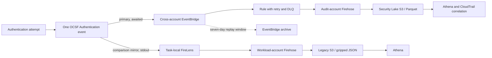

# Audit transport comparison evidence

Status: healthy-path comparison passed; EventBridge and Security Lake selected
for security audit events, subject to the limitations and follow-up work below.

Do not add account IDs, role ARNs, bucket names, query locations, credentials,
raw audit events, or private evidence paths to this file.

## Executive decision

Use the cross-account EventBridge to Security Lake architecture as the platform's
security-audit path. It gives the application a meaningful EventBridge acceptance
result, isolates the retained data from workload administrators, and provides
explicit retry, dead-letter, replay, alarm, OCSF, and CloudTrail-correlation
capabilities.

Retire the FireLens audit mirror after the comparison resources are no longer
needed. FireLens remains appropriate for ordinary application logs, where its
very small request-path cost and simple stdout integration are useful. Its
task-local buffer and lack of a durable producer receipt make it a weaker
boundary for security audit evidence.

The selected path is not a zero-loss design. Authentication deliberately fails
open when audit publication fails, and EventBridge acceptance does not prove
that Security Lake persisted the event. A transactional producer outbox remains
the required follow-up if the system must survive a process failure between the
business action and durable audit acceptance.

## Architectures compared

The same six generated event identities were observed in both stores. This
compares the complete deployed architectures, including their different final
stores and catalog behavior; it is not a microbenchmark of EventBridge against
Fluent Bit.

## Method

- Date: 2026-10-15
- Source revision: `bf670823b741`
- Evidence schema: `audit-transport-comparison/v1`
- Sanitized run ID: `09942a2d`
- Inputs: three accepted and three rejected login attempts
- Expected HTTP results: `200` for accepted credentials and `401` for rejected
  credentials
- Reconciliation key: stable OCSF `metadata.uid` returned as `audit_event_id`
- Store timeout: 1,200 seconds
- Poll interval: 30 seconds
- Delivery buffering: both Firehose streams configured for 60 seconds
- Security Lake catalog behavior: the runner started the Glue crawler after the
  new partition had not yet become queryable

The runner did not retry login requests. It recorded each response and then
queried both stores for the resulting event identities. After reconciliation it
checked the central target DLQ and delivery alarms.

## Results

| Measure | EventBridge to Security Lake | FireLens to legacy S3 |
| --- | ---: | ---: |
| Events found | 6 / 6 | 6 / 6 |
| Accepted outcomes found | 3 / 3 | 3 / 3 |
| Rejected outcomes found | 3 / 3 | 3 / 3 |
| Detection-delay minimum | 167 s | 16 s |
| Detection-delay median | 167.5 s | 57 s |
| Detection-delay mean | 167.7 s | 57 s |
| Detection-delay maximum | 169 s | 98 s |
| Durable producer acceptance visible to the application | EventBridge entry acceptance | No; successful stdout write only |
| Final representation | OCSF Parquet | Gzipped OCSF JSON |
| Administrative boundary | Separate audit account | Workload account |

All six HTTP responses matched their expected authentication result, all six
responses carried an audit event identity, and the runner found no unaudited
login. At the end of the run the central target DLQ contained zero messages and
no delivery alarm was in `ALARM`.

The delay is **detection time**, measured from the login until a 30-second poll
first observed the event. Security Lake's 167-169 second result includes
Firehose buffering, JSON-to-Parquet conversion, crawler execution, partition
registration, and Athena visibility. The legacy values form two small groups
(16-18 and 96-98 seconds), consistent with batch timing and polling. These
figures therefore describe this run's investigator-visible delay; they are not
transport-only latency or an SLA.

The current ECS task's cumulative publish metric provided supporting request-path
evidence:

| Publisher role | Samples in current task aggregate | Mean | Minimum | Maximum |
| --- | ---: | ---: | ---: | ---: |
| Primary EventBridge publisher | 24 | 49.60 ms | 10.97 ms | 194.61 ms |
| Comparison stdout publisher | 24 | 0.082 ms | 0.043 ms | 0.255 ms |

The collector exports cumulative statistic sets, so those 24 samples include
earlier events handled by the same task. They are supporting operational data,
not a six-event, run-exclusive benchmark, and they do not support percentile
claims. Stdout is much cheaper on the request path, but that timing ends before
FireLens or Firehose durably accepts the event.

## Availability

There are two distinct availability concerns: whether login remains available
and whether the audit pipeline remains available.

- Authentication fails open in both designs. An audit outage does not turn a
  valid login into an application outage. On the selected path, an EventBridge
  problem can add the bounded publisher timeout before the login completes and
  produces a visible unaudited-login signal.
- The primary ingress is a regional managed EventBridge service. AWS publishes a
  99.99% regional monthly uptime commitment for EventBridge. That is a service
  commitment, not an end-to-end guarantee for this multi-service pipeline.
- The legacy ingress begins in an essential FireLens sidecar inside the same ECS
  task as the application. Its availability and buffered records are coupled to
  the task lifecycle before managed Firehose receives anything.
- Both designs depend on Firehose, S3, Glue metadata, and Athena for eventual
  investigation. A temporary catalog or Athena problem can delay queries even
  when the underlying object is already durable.

## Durability

| Stage | EventBridge and Security Lake | FireLens and legacy S3 |
| --- | --- | --- |
| Application handoff | The SDK call is awaited, partial failures are inspected, and a receipt is returned only for an accepted entry. | The application writes to stdout; this does not acknowledge FireLens, Firehose, or S3 persistence. |
| In-flight recovery | Rule delivery has a 24-hour event-age limit, up to 185 attempts, and a 14-day target DLQ. A seven-day EventBridge archive supports replay of accepted events. | Fluent Bit retries and buffers locally, but the deployed buffer is bounded and dies with the Fargate task. |
| Failed conversion | Firehose writes failed conversion records to a separately scoped quarantine prefix. | The legacy path has its existing Firehose failure handling but no central replay archive. |
| Final object store | Security Lake stores partitioned Parquet in S3. | The legacy archive stores gzipped JSON in S3. |
| Administrative isolation | Workload administrators cannot delete the audit-account store through the workload stack. | A workload-account administrator can alter or delete the archive and its pipeline. |

Once data reaches S3, both designs benefit from S3's durability. AWS states that
S3 Standard is designed for 99.999999999% annual object durability and 99.99%
availability across at least three Availability Zones. The important durability
difference is therefore before S3: the selected path has an acknowledged managed
handoff plus recovery buffers, while the legacy path first relies on an
unacknowledged task-local buffer.

The archive and DLQ are bounded recovery mechanisms, not the authoritative audit
archive. Duplicate delivery remains possible. The stable `metadata.uid` must be
preserved through retries and replay so investigations can deduplicate events.

## Reliability and operability

The selected architecture is more observable when something goes wrong:

- publisher failures are bounded, classified, measured, and alarmed;
- rule delivery has explicit retry and a target DLQ;
- accepted events can be replayed from the EventBridge archive;
- conversion failures are kept outside the valid Security Lake dataset;
- Security Lake uses OCSF and Parquet, enabling consistent fields and direct
  correlation with native CloudTrail data;
- the audit account reduces the blast radius of workload deployment and
  administrator mistakes.

It also has more moving parts. EventBridge, cross-account permissions, Firehose
conversion, Lake Formation, Glue partitions, a crawler, Athena, replay, and DLQ
operations all need ownership and runbooks. A misnamed or missing EventBridge
bus deserves special attention: AWS documents that `PutEvents` can return HTTP
success while discarding an entry sent to a nonexistent bus. Deployment
preflight, post-deploy smoke testing, publisher metrics, and end-to-end canaries
must protect that boundary.

The legacy architecture is easier to understand and became queryable sooner in
this run. It remains a sound application-log transport when occasional loss at
task failure is acceptable. Its simplicity does not compensate for the missing
durable acceptance boundary when the record is security evidence.

## What this run did not prove

- Six healthy-path events are demo evidence, not a statistical latency study or
  an availability measurement.
- No ECS task was killed while FireLens held buffered records.
- No EventBridge access denial, SDK timeout, missing bus, exhausted retry,
  Firehose failure, DLQ redrive, archive replay, or duplicate was injected.
- A zero-depth DLQ and quiet alarms show no observed delivery failure in this
  run; they do not prove that the failure controls work.
- The comparison did not prove zero loss between the successful business action
  and audit publication. The fail-open window remains until a producer outbox
  exists.
- Security Lake query delay included a manual crawler start. Production freshness
  needs a defined catalog-refresh schedule or another partition-management
  mechanism.

## Recommendation and follow-up

1. Keep EventBridge to Security Lake as the selected Authentication audit path.
2. Preserve this sanitized report and the private raw evidence separately.
3. Remove the comparison stdout mirror and legacy audit infrastructure after the
   environment teardown has preserved any evidence still needed.
4. Implement the transactional audit outbox tracked by
   [issue #76](https://github.com/movie-reservation-platform-lab/movie-platform-infra/issues/76)
   if committed business actions require stronger no-gap semantics.
5. Schedule catalog refresh and document DLQ redrive, archive replay, quarantine,
   and duplicate-handling procedures.
6. Run a focused failure exercise covering task termination, denied EventBridge
   publication, failed target delivery, DLQ recovery, and archive replay before
   making a stronger reliability claim.
7. Add a periodic end-to-end canary that reconciles a unique event identity in
   Security Lake and alarms when the bounded freshness objective is missed.

## Sources

- Repository design and measurement contract:
  [audit transport comparison](../audit-transport-comparison.md) and
  [EventBridge/Security Lake audit design](../eventbridge-security-lake-audit-demo.md)
- AWS EventBridge:
  [retry and DLQ behavior](https://docs.aws.amazon.com/eventbridge/latest/userguide/eb-rule-retry-policy.html),
  [archive and replay](https://docs.aws.amazon.com/eventbridge/latest/userguide/eb-archive.html),
  [`PutEvents` failure semantics](https://docs.aws.amazon.com/eventbridge/latest/userguide/eb-putevents.html),
  and the [EventBridge SLA](https://aws.amazon.com/eventbridge/sla/)
- AWS storage and task logging:
  [S3 storage properties](https://docs.aws.amazon.com/AmazonS3/latest/userguide/storage-class-intro.html)
  and [FireLens buffering behavior](https://docs.aws.amazon.com/AmazonECS/latest/developerguide/firelens-docker-buffer-limit.html)
- AWS Security Lake:
  [custom source requirements](https://docs.aws.amazon.com/security-lake/latest/userguide/custom-sources.html)
  and [OCSF normalization](https://docs.aws.amazon.com/security-lake/latest/userguide/open-cybersecurity-schema-framework.html)
